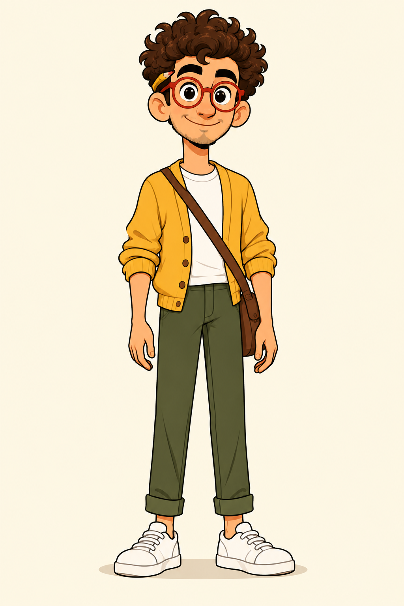

# Personaj: KAXO

> KAXO kanalının aparıcısıdır. İnsana bənzər **universal** 2D cizgi personajdır (sahib, 2026-10-31): mövzuya görə geyimi və əlindəki əşyalar dəyişir, siması dəyişmir.
> Ad eyni qalıb, görünüş dəyişib: köhnə kaktus KAXO arxivdədir (`content/archive/kaxo/character/`), yeni KAXO insana bənzər gənc kişidir. Kanal loqosu və banneri yeni KAXO ilədir (YouTube-da 2026-10-31): `content/assets/brand/`, yenidən render `node tools/brand/render.js`. Kanal təsviri (Description) hələ köhnə mətndir.



**Referans şəkil:** `content/character/reference.png` (2026-10-31, ChatGPT, sahib 3 variantdan 2-cini seçdi: `design/variants-01.png`). Hər şəkil generasiyasına **mütləq** əlavə olunur.
Əlavə vərəqlər: `expressions.png` (təəccüb, gülüş, düşüncə, göstərmə) və `outfits.png` (yemək önlüyü, tarixəqədərki tunika, sahə gödəkçəsi, laboratoriya xalatı). Personaj ChatGPT-nin "Choose KAXO Design Version" söhbətində yaradılıb (KAXO hesabı).

## Kimdir
- KAXO, ~28 yaşında kişi, hər şeyə "niyə?" deyən maraqlı tədqiqatçı və hekayəçi. Yemək, tarix, heyvanlar, insan bədəni: sualın mövzusu fərq etmir, cavabın arxasında həmişə bir hekayə axtarır.
- **Xasiyyəti:** maraqlı, hazırcavab, isti, bir az səliqəsiz. Faktı sevir, amma mühazirə oxumur, hekayə danışır. Təəccüblü faktda gözləri böyüyür, "wait, what?" deyir.
- **Rolu videoda:** izləyicini səhnələrə aparır (Tokyo, 1965; buz dövrü düşərgəsi; Roma hamamı), xəritədə göstərir, viktorina soruşur, Answer Puzzle-ı tamamlayır. Tarixi səhnəyə "girəndə" həmin dövrün geyimini geyinir.
- **Yumoru:** özünə ironiya, müasir həyatla müqayisə ("Thirty roommates and one cave. I can't even share a fridge."), danışan heyvanlara cavab verməsi.
- **Heç vaxt:** başqa mədəniyyəti ələ salmır, "iyrənc" demir, tibbi məsləhət vermir, uşaqlara müraciət tonu işlətmir (RULES §12.4).

## Görünüş: dəyişməz lövbərlər (hər geyimdə eyni qalır)
Personajı hər kostyumda tanıdan şeylər bunlardır. Heç bir səhnədə dəyişdirilmir:
- Gənc kişi, ~28 yaş, mehriban, ifadəli üz, isti zeytuni dəri (bir millətə bağlanmayan, qlobal görünüş), yüngül saqqal kölgəsi (çənə və bığ yerində).
- **Saç:** tünd şabalıdı, sıx buruq, başın üstündə iri həcmli dağınıq buruqlar, alnına bir neçə buruq düşür. **Sağ qulağının arxasında sarı karandaş** var.
- **Gözlər və eynək:** böyük tünd qəhvəyi gözlər, iri dəyirmi qalın **tomat-qırmızı çərçivəli eynək**.
- **Bədən:** cizgi proporsiyaları (baş bədənə görə bir az böyük), uzunboy, ince bədən, enerjili duruş.
- **İmza aksessuarı:** kiçik qəhvəyi kətan çanta çiynindən çarpaz asılır (tarixi kostyumda da: dəri və ya parça versiyası).

Kostyum saçı örtsə belə (dəbilqə, papaq), qulağın arxasındakı karandaş və qırmızı eynək görünür qalır.

## Geyim və əşyalar (mövzuya görə dəyişir)
**Əsas geyim** (kostyum lazım deyilsə, studiya və müasir səhnələrdə): xardal-sarı yumşaq hırka, qolları dirsəyə qədər çırmanıb; ağ köynək; zeytun-yaşıl şalvar; ağ kedlər.

Epizod üçün `episode.json` → `outfit` və `props` bir dəfə seçilir və epizod boyu eyni qalır. Nümunələr:

| Mövzu sahəsi | Geyim (`outfit`) | Əşyalar (`props`) |
|---|---|---|
| Yemək | əsas geyim + qısa tomat-qırmızı önlük | taxta qaşıq (göstərici kimi), boşqab, bazar səbəti |
| Tarixəqədərki həyat | qəhvəyi dəri tunika, dəri çəkmələr, çanta dəridən | məşəl, daş alət, sümük iynə |
| İxtiralar və gündəlik əşyalar | əsas geyim + mavi iş önlüyü, alnında qoruyucu eynək (öz eynəyi altda) | açar, kərpic, sabun qəlibi, eskiz dəftəri |
| Heyvanlar və təbiət | xaki sahə gödəkçəsi, cibli şalvar, ekspedisiya papağı | durbin, sahə dəftəri |
| İnsan bədəni və beyni | açıq-mavi laboratoriya xalatı əsas geyimin üstündən | beyin maketi, göstərici çubuq |
| Tarixi dövrə "giriş" | dövrün sadə geyimi (Roma tunikası, Edo kimonosu, Viktoriya paltarı) | dövrün əşyası |

**Fərqləndirmə qaydası:** referans kanalların personajlarına oxşarlıq olmamalıdır. KAXO yaşıl kapüşon geyinmir, böyüdücü şüşə tutmur, ağ dəyirmi başlı çöp adam (stickman) üslubunda çəkilmir. Referans kanaldakı dağınıq qara saçlı oğlana bənzəməməsi üçün saçı buruq şabalıdı, eynəyi qırmızıdır.

## Videoda KAXO: kodla idarə olunan puppet (RULES §5.0)
Video səhnələri ChatGPT ilə yaradılmır. KAXO videoda `content/assets/kaxo-rig/`-dəki vektor qatlarından (baş, gözlər, ağız formaları, qollar, kostyumlar) Remotion-da kodla animasiya olunur. Rig bu səhifədəki dizayn vərəqlərindən qurulur. Aşağıdakı stil prompt-u və ardıcıllıq bloku yalnız **thumbnail** və yeni dizayn vərəqləri üçündür.

## Stil prompt-u
```
Create a clean 2D cartoon illustration in the style of a modern animated educational explainer for adults. Use bold, smooth black outlines, bright flat colors with very soft simple shading, expressive faces with big eyes, slightly exaggerated proportions and clear readable silhouettes. Backgrounds are simplified but colorful and atmospheric, so the characters stand out. The mood is curious, warm and lightly funny. No gore, no nudity.
```

## Ardıcıllıq bloku (KAXO olan hər səhnə prompt-unun sonuna)
`{OUTFIT}` və `{PROPS}` epizodun seçimindən, `{ASPECT}` formatdan: long `Horizontal 3:2 (landscape, leave some space around the character)`, short `Vertical 2:3`.

```
Keep KAXO's identity EXACTLY as in the attached reference image: same young man's face, warm olive skin, light stubble, big dark-brown eyes, chunky round tomato-red glasses, voluminous dark-brown curly hair (big messy curls on top, a few curls on the forehead), a yellow pencil tucked behind his right ear, small brown crossbody bag. In this scene he wears: {OUTFIT}. He holds or uses: {PROPS}. Do not change his face, hairstyle or glasses. No text, no captions, no watermark. {ASPECT} image.
```

KAXO olmayan səhnələrdə ardıcıllıq bloku işlədilmir: stil prompt-u + `No text, no captions, no watermark. {ASPECT} image.`

## Referansın yaradılması (edildi 2026-10-31; görünüş dəyişərsə təkrarlanır)
1. ChatGPT-də (Claude in Chrome, sahibin hesabı, `/video` 5-ci addım qaydaları) yeni söhbət: stil prompt-u + "Görünüş" və "Əsas geyim" ingiliscə + "Full-body character reference sheet: front view, three-quarter view and side view of the same character standing on a plain light background, neutral friendly smile. No text."
2. 3 variant alınır, sahibə göstərilir, sahib birini seçir.
3. Seçilən görünüşdən:
   - `reference.png`: tək tam boy, öndən, əsas geyimdə, açıq düz fon;
   - `expressions.png`: 4 ifadə (təəccüb, gülüş, düşüncə, "wait, what?");
   - `outfits.png`: eyni KAXO 4 kostyumda (yemək önlüyü, tarixəqədərki tunika, sahə gödəkçəsi, laboratoriya xalatı). Bu vərəq lövbərlərin kostyumda qorunduğunu yoxlayır.
4. Fayllar `content/character/`-ə. Uğurlu səhnə şəkilləri sonradan `content/character/poses/`-a gedir (README cədvəli ilə, fayl adında geyim).
5. Seçilmiş görünüşdə detal dəyişibsə (məsələn, eynək rəngi), bu fayldakı "Görünüş" və ardıcıllıq bloku eyni anda yenilənir.

## Səs
| Rol | Default | Tərz |
|---|---|---|
| `kaxo` | `bm_fable`, speed 1.02, `lang: en-us` (sahib seçib, 2026-10-31; `tts.py` DEFAULT_VOICES, nümunə `content/voice-samples/narrator__bm_fable__en-us.wav`) | isti, aydın, maraqlı; normal temp ~1.02, təəccüb anında 1.07, zarafatda 0.95 |

- Səs dəyişərsə: `tools/video/voice_samples.py` ilə namizədlər eyni cümlələrlə oxunur, sahib qulaqla seçir, seçim bu cədvələ və `tools/video/tts.py` → `DEFAULT_VOICES["kaxo"]`-a yazılır.
- Tək aparıcı KAXO-dur. Danışan heyvan və ya əşya üçün qısa bir sətir başqa səslə ola bilər (epizodun `voices` sahəsində).
- Danışıq qaydaları: RULES §4. Ödənişli TTS (ElevenLabs və s.) yalnız sahibin icazəsi ilə.

## Thumbnail pozaları
Şablon və siyahı [../THUMBNAILS.md](../THUMBNAILS.md)-dədir. Hər pozada personajın lövbərləri dəyişmir, yalnız ifadə, bədən, geyim və əşya dəyişir.
